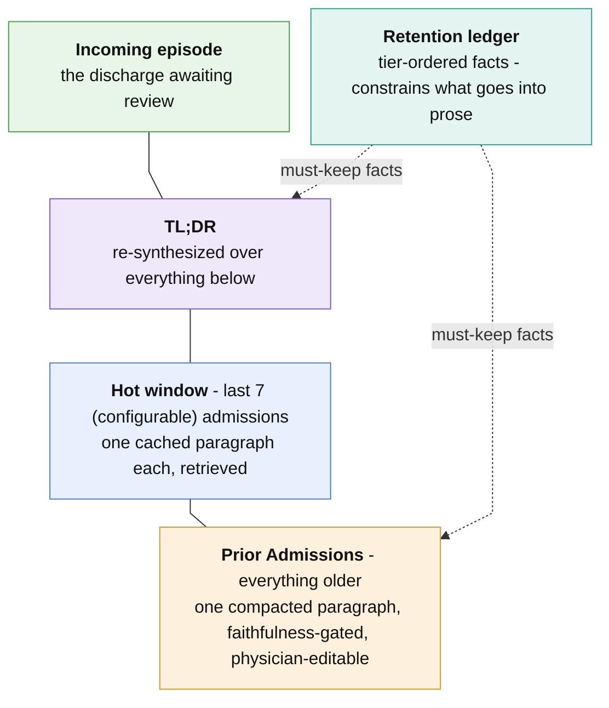
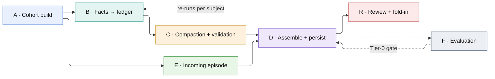
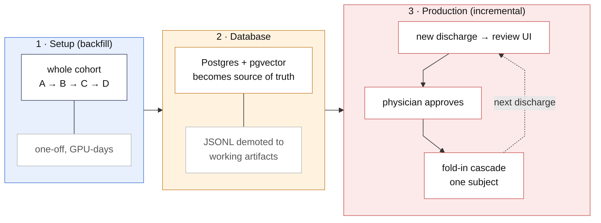

# **CLINICAL LONGITUDINAL SUMMARIES** (CLIN-LONGSUM)

**Tiered longitudinal clinical summarization.** Compacts a patient's multi-admission history into
two coupled artifacts: a structured **retention ledger** of must-keep clinical facts on a 5-tier
salience taxonomy, and **prose summaries** that decay with age. Nothing enters the
established record without clinician review. All inference can run locally.

**Status:** research prototype. Built and tuned on a 100-patient development cohort; externally
checked on a 10-patient unseen cohort. Please validate on your own data for clinical use. See *Evaluation and
limitations*.

> **Data-use notice.** Developed against MIMIC-IV-Ext-BHC. 
> **No patient-derived data ships in this repository** (see `.gitignore`). If using MIMIC-IV-Ext-BHC dataset, 
you should obtain credentials from PhysioNet and build data at runtime (see `setup\DATA_PREP.md` for details).  

> **Not a medical device.** Research software with no regulatory clearance. 

This README is best understood if read together by clinicians and AI-developer teams - clinical and engineering terms are liberally interweaved throughout.

---

## Who is this for

The scenario: A patient with a dozen admissions arrives at clinic. His record holds more history than anyone
can read in the minutes before the consult. Two self-evident approaches are both inadequate:

- **Concatenate everything.** Grows without bound, so readers skim instead of read.
- **Summarize the lot.**  LLM summarization tends to be biased by **primary and recency (1), not salience**; a summarizer left to itself faithfully reproduces last month's admission and quietly drops the penicillin anaphylaxis from 2019.

So our design separates the two jobs. A prose section handles readability and decays with age, while a ledger
handles memory and does not decay - it is built independently, tier-ordered by clinical consequence, and constrains what the prose is allowed to forget. 

CLIN-LONGSUM helps in clinical settings where patients have multiple complex problems, multiple admissions, and management by multiple disciplines. The patient's primary care physician, the ED physician of the hospital where he may present, the co-ordinating physician in-hospital, and the referred subspecialty physician can all be more productive in their information gathering with this tool. 


### Governing principles

- **Physician decisions override machine decisions.** Generated and physician-authored text
  are tagged with separate provenance. Regeneration always pins a physician's edit and re-queues it; it never silently overwrites.
- **Nothing is folded into the established record without review.** Approval is an explicit physician act.
- **Every displayed fact is traceable** to a `fact_id` and a source admission.
- **Local inference only.** No patient data leaves the machine if institutional policy requires so.
- **Append-only audit trail.** Decisions are persisted to database, and corrections are recorded
  rather than applied invisibly.

---

## What it produces

### 1. The retention ledger

The heart of the ledger is a **clinical salience taxonomy** that guides how and why facts are deemed salient, and thus retained, across time. See `References\clinical_salience_taxonomy.md` for details. **You should assess if this taxonomy fits your healthcare institution's patient population**; any changes to the taxonomy is likely to require potentially extensive script edits to conform to an edited taxonomy. See `TAXONOMY_EXTENSION.md` for details.

The ledger is per-patient, structured, partially deduplicated (full deduplication would have lost salient facts). 
Each fact node carries a salience tier (T1 highest consequence to T5 lowest), one of 12 retention classes, 
the `fact_id`s that built it, and per-attribute provenance.

| Tier | Meaning | Examples |
|---|---|---|
| **T1** | Never drop. Acting without it can kill. | severe ADR / allergy, infection-control status, code-status directive |
| **T2** | Permanent alterations to the patient. | sentinel event, implanted device, anatomy-altering surgery, permanent condition, altered immune status, transfusion/obstetric history |
| **T3** | Chronic state, roll up to current status. | chronic disease states |
| **T4** | Recurrent pattern, collapse to a count and a course. | recurrent acute flares of chronic lung disease, recurrent UTI episodes|
| **T5** | Transient, safe to prune once resolved. | transient event |

Dropped facts are not discarded silently - they land in database (`retention_dropped` table) with a reason, queryable after
the fact.

### 2. The prose tiers

What the physician actually reads, oldest compressed hardest:



Cost stays bounded as history grows: only a newly-aged admission is folded into the compacted
tier, so a patient with 40 admissions costs about what a patient with 10 costs.

**See it in action.** [`References/physician_ui_mockup.html`](References/physician_ui_mockup.html) is a static,
single-file mockup of the physician review UI (`src/api/tiered_review.html`). It shows the prose
tiers and the retention ledger for a fully synthetic patient with 10 admissions: 1 incoming, 7 un-compacted (the
previous admission plus 6 recent admissions) and 2 compacted. All data in the mockup is fictional. Download
the file and open it in a browser. 

> **Scope.** This pipeline generates the *narrative* tiers and the ledger only. Coded diagnoses, imaging results, labs and
major procedures are often stored by healthcare institutions separately as structured data and are thus not included.

---

## How it works



Full stage-by-stage reference, with the data-flow and fold-in diagrams: **`References/PIPELINE.md`**.

---

## Design highlights

**The ledger counterweights the prose.** Facts are extracted per admission and projected into a per-patient ledger deterministically (`b2`), then consolidated tier-aware by an LLM (`b4`: chronic states roll up, recurrent episodes collapse, transient events prune by recency). The
ledger is built from the source notes, not from the prose, so it does not inherit the prose's recency bias. The compactor is bound by the ledger.

**Compaction is incremental, not regenerative.** `c1` seeds from the previous compaction result and folds in only the newly-aged admission. Compacted text stays stable across runs instead of being rewritten each time, and physician-edited text is frozen byte-exact as a prefix ahead of the machine continuation.

**Four-step faithfulness validation.** Generate, validate, correct, gate. The validator is adapted from SynthMedic (Grazhdanski et al. 2025), every claim in the compacted prose must be traceable back to the source admissions. `c3` gates on the presence of unsupported statements, `c4` rewrites them, and the correction trail is persisted to the database.

**Holdout as evaluation.** The most recent admission per patient is withheld to simulate an
incoming discharge, so the system is always assessed against a note it has not seen. Physician
approval promotes it, and the fold-in cascade rebuilds that patient's record with the new admission
in place. Build-time batch and runtime fold-in run the same code.

---

## Quickstart

```bash
# 1. Python deps (3.10+; install a CUDA torch build first if using GPU)
pip install -r setup/requirements.txt

# 2. Models, served locally by Ollama, swappable with your models of choice
ollama pull ornith:35b          # generation (all roles)
ollama pull deepseek-r1:32b     # judge / faithfulness validation

# 3. Configure
cp .env.example .env            # Postgres creds + LONGSUM_SOURCE_CSV

# 4. Database: Postgres + pgvector, apply the DDL  -> setup/DB_SETUP.md
# 5. Source CSVs from your credentialed data       -> setup/DATA_PREP.md

# 6. Cold build (from src/)
cd src
python a1_profile_cohort.py && python a2_build_cohort.py
cd database && python a4_load_and_embed.py && cd ..
python b1_retention_extractor.py --fresh
python b2_build_ledger.py && python b4_consolidate_ledger.py
python d1_paragrapher.py --fresh && python c1_compactor.py --fresh
python c3_faithfulness.py --fresh && python c4_correct.py --fresh
python d2_tldr.py --fresh && python d_coordinator.py --write-md
cd database && python d3_load_tiers.py

# 7. Review service
cd ../api && uvicorn longsum_api:app --host 127.0.0.1 --port 8000
```

### Hardware and runtime

- **VRAM.** The two models are never co-resident - the generator unloads before the judge loads. At
  Q4_K_M that is 21 GB (ornith:35b) and 19 GB (deepseek-r1:32b), so a single 24 GB card runs the
  whole pipeline. A second GPU lets the judge stay resident and cuts wall-clock materially.
- **CPU-only works** but is much, much slower; the CUDA path is skipped automatically. 
- **Wall-clock.** Budget the cold build for **3 to 5 DAYS** for a cohort of about 100 patients with consumer-grade 24Gb GPU; `b1` and `c1`  are the longest.  In production mode, after initial setup, each fold-in of a new admission's summary takes about 30mins to 1hr; 
this runs in the background while you do other tasks, completion is visible on console, there is no alert message.

---

## Deployment phases



**1 · Setup.** Batch over the existing discharge corpus. Builds every patient's ledger and prose
tiers cold. Run once per corpus, or after a taxonomy version bump.

**2 · Database.** Postgres holds the served record, the promotions table, compaction gates, and
correction provenance. On-disk JSONL are working artifacts.

**3 · Production.** Each new discharge arrives as an incoming episode, is reviewed, and on approval
triggers `foldin_patient.py`, which re-runs the cascade for that one subject under a session-level
Postgres advisory lock. Concurrent fold-ins serialize; the lock auto-releases on crash.

**Re-run rule: IMPORTANT** `b2` must always be followed immediately by
`b4` before any stage reads the ledger. `b4`'s backup logic keys off a `consolidated` marker, so an
interleaved read gets an unconsolidated ledger.

---

## Data source

Built against **MIMIC-IV-Ext-BHC** (PhysioNet, credentialed). The pipeline is dataset-agnostic: any
corpus with subject ids, ordered admissions, and a brief-hospital-course text field will work.

- Two source CSVs go in `data/input/`. Building them: **`setup/DATA_PREP.md`**.
- The optional ICD to SNOMED map requires your own UMLS licence; please comply with UMLS licensing restrictions.
- Required citations for MIMIC: **`References/CITATIONS.md`**.

> **Date-handling trap.** Source CSVs are day-first (D/M/YYYY). `src/cohort.py` is the single
> `dayfirst`-parsed loader; pipeline ordering uses the numeric `admit_seq`, never parsed dates.
> **Never open a pipeline CSV in Excel** - it silently reformats dates and booleans on save.

---

## Technical choices

**Ollama for serving.** Trivial to install and deploy, local by construction. The model becomes a
config parameter rather than an integration. 

**Generator - Ornith-1.0-35B.** Mixture-of-experts, so inference is fast for its class, and it
outperforms its Qwen3.5-35B-A3B base on published coding and agentic benchmarks. MIT licensed,
open-weight, fits a consumer card at Q4_K_M.

**Judge - deepseek-r1:32b.** A reasoning model with different model-family generation and independent
post-training from the generator, chosen to reduce shared failure modes. Note that both derive from
Qwen bases, so the independence is partial. MIT licensed, open-weight, consumer-sized.

**Embeddings - `Snowflake/snowflake-arctic-embed-l-v2.0`.** Fast, general-purpose, strong medical
MTEB performance, Apache-2.0. Runs locally via sentence-transformers.

**Zero-shot for both roles.** No fine-tuning to maintain, no retraining when the data or taxonomy
moves, and no training-data governance burden on top of the existing DUA. Prompt and taxonomy changes
take effect immediately, helpful when a clinician is tuning tier definitions.

**Every role is a bound `ModelSpec`** in `config.py`, and swaps are recorded in each audit record, so
a summary can always be traced to the model that wrote it.

---

## Evaluation and limitations

Phase-F gates (`src/evaluation/f1`..`f12`) read the generated artifacts read-only and score salience
recall, ledger integrity, compression, faithfulness, and reference behaviour. Three tiers: Tier 0
deterministic (blocks the build), Tier 1 LLM-judge (tracked or soft-gated), Tier 2 periodic
calibration (off the build path). Full detail: **`References/EVALUATION.md`** for devs and **`References/EVALUATION_CLINICAL.md`**
for clinicians.

### Generalization

The pipeline was rerun end-to-end on an unseen cohort separate from the development cohort:

| Metric | Dev | Unseen | Gap |
|---|---|---|---|
| Salience-weighted retention (lenient) | 0.9965 | 1.0000 | -0.0035 |
| Salience-weighted retention (strict) | 0.9960 | 0.9955 | 0.0005 |
| Faithful fraction | 0.991 | 0.989 | 0.002 |

Gaps near zero, in the direction of no overfitting to the dev cohort. **The unseen cohort was 10
patients.** You should conduct your own generalization run, preferably with more patients.

### Known limits, 

- **The LLM judge is not trustworthy enough to gate alone.** Not-Supported PPV is approximately 0.24
  against clinician ground truth (agreement ~78%, Gwet's AC1 0.721), so human-reviewed triage is the
  supported use. This is based on quantized deepseek-r1:32b; you may want to experiment with other models.
- **Contradiction flags over-fire.** On the test cohort, 3 of 5 flagged contradictions were false
  positives, mostly expected disease progression read as a stage conflict. Accepted as tolerable, but
  budget review time for it.
- **Salience-recall gates are advisory**, requiring sign-off rather than blocking a release.
- **Tested on patients with roughly 3 to 15 admissions.** Behaviour at lifetime scale - potentially hundreds of
  admissions - is untested.
- **Behavioural-health corpus.** The taxonomy was tuned against BHC notes. The tier structure should
  transfer; but the class definitions and thresholds may need revisiting if using your own corpus.
- Catalogued defects and their mechanisms: **`References/KNOWN_FAILURE_MODES.md`**. 

**Run it on your own data before you believe any of these numbers.** The figures above comes from the MIMIC-IV corpus. The evaluation harness is included precisely so you can regenerate them against yours. 

---

## Adapting this to your site

**Clinical - a clinician owns these.** Tier assignments, retention-class definitions, gate
thresholds, what counts as a safety-critical fact, and which classes are exempt from splitting or
pruning. These are clinical judgements with patient-safety consequences. Clinical decision points are catalogued 
with their trade-offs in **`References/clinical_tuning_points.md`**.

In most institutions, clinical decisions are likely governed by a clinical governance board. We recommend that clinician
user-champions run small pilots with your own data, evaluate the outputs and review `References/clinical_tuning_points.md` 
before submitting to your governance board for implementation consideration. 

**Engineering - your dev team owns these.** Source-note schema and extraction, note types beyond
BHC, database topology, deployment and scaling, EHR integration, and authentication for the review
UI. The pipeline assumes one Postgres, one Ollama host, and a physician at a browser; your dev team may propose 
additional design work. For example: (1) the project ships with a rudimentary physician UI as an initial reference,
but you'll probably want to enhance it, eg by linking it to your physician database; (2) you may want to add a mechanism
for 2-physician review (often a junior and an attending); (3) add a mechanism for later correction of physician edits.

Most sites will want to retune the salience taxonomy first, since it encodes which facts matter at
your institution. `src/retention_taxonomy.py` is the single definition point,
the extraction prompt is generated from it, and the database does not constrain the vocabulary. Cost
varies sharply by change, though - altering a **pin rule** re-derives from b2 onward in minutes,
while **re-tiering a class** or **adding one** forces a full b1 re-extraction, measured in GPU-hours for a 100-patient cohort.
A dozen sites outside the taxonomy module restate class ids and tier names and must move in lockstep;
the evaluation gates in particular mis-score silently if missed rather than raising. Procedures, cost table, the lockstep checklist, migration caveats, and re-run and verification order:
**`References/TAXONOMY_EXTENSION.md`**.

---

## The forensic assistant

`skills/longsum-forensics/` ships an agent skill, for use with Claude, that helps answers questions related to the pipeline.
Given a `subject_id`, `hadm_id`, or `fact_id`, it traces a fact stage by stage through the artifacts -
where it entered, how the taxonomy classified it, where it was merged, dropped, or rewritten - and
verifies against the source text as ground truth. It also answers pipeline-behaviour questions: what a
warning means, why the UI differs from the CSV, why something was classified chronic.

It is read-only and deliberately re-reads live code rather than relying on recalled behaviour. Setup: **`References/FORENSIC_AGENT_SETUP.md`**.

---

## Repository layout

```
clin_longsum/
  src/
    a1..a2                cohort draw            b1..b4   retention ledger
    c1..c5                compaction + QA        d1..d3   prose tiers + assembly
    e1..e2                incoming episode       foldin_patient.py  fold-in orchestrator
    config.py, holdout.py, retention_taxonomy.py, ledger_consolidate.py
    api/                  FastAPI review service + tiered_review.html
    database/             DB loaders + SQL DDL
    evaluation/           Phase-F gates f1..f12
    vendor/               text_cleaner, ollama_utils, faithfulness_validator
    resources/            dictionary_abbreviations.tsv (curated, ships)
    roles/                model-binding contracts
  setup/                  requirements.txt, DB_SETUP.md, DATA_PREP.md
  References/             pipeline, evaluation, taxonomy, tuning, failure modes
  skills/                 forensic assistant
  data/                   ALL data lives here - gitignored, never committed
```

Scripts use flat imports and run from their own directory; subfolder scripts import a small
`_bootstrap.py` that puts `src/` on the path. Paths derive from `config.py`'s own location, so the
repo relocates cleanly.

---

## Documentation map

| Document | Answers | For |
|---|---|---|
| `References/PIPELINE.md` | What each stage does, in what order, reading and writing what | both |
| `References/EVALUATION_CLINICAL.md` | what and how to evaluate | clinical | 
| `References/EVALUATION.md` | What is measured, how, and what gates on it | dev |
| `References/clinical_salience_taxonomy.md` | The 5-tier system and its clinical reasoning | clinical |
| `References/clinical_tuning_points.md` | Every site-specific clinical decision, with trade-offs | clinical |
| `References/KNOWN_FAILURE_MODES.md` | Catalogued defects and their mechanisms | both |
| `References/MODEL_SELECTION.md` | Choosing and configuring the LLM behind b1 extraction when forking onto your own notes | dev |
| `References/REPAIR_RUNBOOK.md` | How to fix things when they break | dev |
| `References/FORENSIC_MAP.md` | Which artifact and field holds what | dev |
| `References/GLOSSARY.md` | Terms of art used throughout | both |
| `References/CHANGELOG.md` | Version history and design decisions | dev |
| `References/CITATIONS.md` | Citations required by the PhysioNet DUA and by CC BY sources | both |
| `References/physician_ui_mockup.html` | What the physician review UI looks like, using a synthetic patient | both |

---

## Licensing and citation

- **Code:** GNU AGPL, version 3 only – see [LICENSE](LICENSE)
- **Reference documents** (`References/`, `skills/`): CC BY-NC 4.0 – see [LICENSE-docs](LICENSE-docs)
- Required citations: **`References/CITATIONS.md`**
- Contribution policy (no pull requests): **`CONTRIBUTING.md`**

AGPL §13 applies: running a modified version of the review service as a network service obliges you to
offer its users the corresponding source of your modified version.


#### References

1. Liu et al., "Lost in the Middle: How Language Models Use Long Contexts," TACL vol. 12 (2024), pp. 157–173