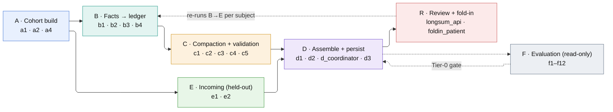
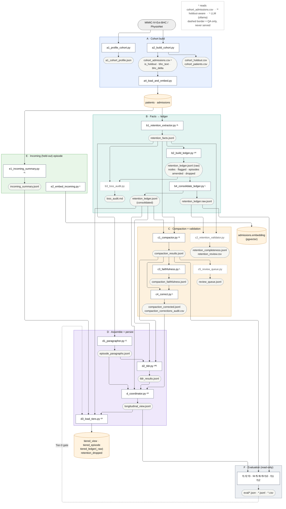

# clin_longsum — pipeline reference

Tiered longitudinal clinical summarization. Per-patient admissions
are extracted to facts, rolled into a retention **ledger** (5-tier clinical salience),
compacted, assembled into a `LongitudinalView`, and loaded to Postgres for a physician
review user interface (UI). In development mode, the **latest** k admissions ( k = 1 or 2) per patient is held out (`is_holdout`) to simulate one or two **incoming** discharges; In k=1 development mode physician approval **folds it in** to the established record. k=2 mode is used for generalization (ie on unseen cases) validation with simulated auto-approval. In production mode, `is_holdout` should be set to  `False`. 

Conventions in the diagrams: `[script.py]` = pipeline stage · `([file])` = file artifact ·
`[(table)]` = Postgres · `{{…}}` = control. Badges: **ᶜ** reads `cohort_admissions.csv`,
**ᴴ** holdout-aware, **ᴸ** calls local Ollama (ornith:35b generation, deepseek-r1:32b validation).
Dashed node border = QA only (never served); dashed edge = control flow. Stage tints are the same
across all three diagrams, so a box in the stage map matches its subgraph below.
The diagrams use the ELK renderer; if yours lacks it, drop `"defaultRenderer": "elk", ` from each
`%%{init}%%` line (the spacing keys still apply under dagre).

> **Never open a pipeline CSV in Excel** (the source CSV, `cohort_admissions.csv`,
> `cohort_holdout.csv`, or any other `data*/interim`/`output` CSV). Excel silently
> reformats dates on open/save (locale-dependent D/M vs M/D, seconds dropped) and
> truncates any cell over 32,767 characters - for this pipeline that's `bhc_text`
> / `bhc_delta`. A resave can corrupt data upstream of every fact, ledger, and
> metric with no error raised. Copy the file first and open the copy if you need
> to inspect it; never resave a working pipeline CSV from Excel.

**1 · Stage map**



**2 · Build data flow** (A–F, forward path only)



**3 · Review + background fold-in**

```mermaid
%%{init: {"flowchart": {"defaultRenderer": "elk", "nodeSpacing": 25, "rankSpacing": 40, "curve": "linear"}}}%%
flowchart TD
    TIER[("tiered_view · tiered_episode<br/>tiered_ledger")]:::db

    subgraph R["R · Physician review"]
        api["longsum_api.py<br/>/tiered/review (FastAPI)"]:::py
        submit[["POST …/submit<br/>approved_summary_md · summary_version"]]:::py
        api - "Approve" --> submit
    end
    TIER --> api

    foldin["foldin_patient.py --subject S --hadm H<br/>pg_advisory_lock "]:::ctl
    submit -. "BackgroundTask" .-> foldin

    subgraph CH["fold-in cascade (per subject, in order)"]
        k1["b1 (one adm) → db_persist_source --facts"]:::stgB
        k2{{"holdout.promote()"}}:::ctl
        k3["b2 → b4"]:::stgB
        k4["c1"]:::stgC
        k5["d1"]:::stgD
        k6["c2 → c3 → c4"]:::stgC
        k7["d2 → d_coordinator → d3"]:::stgD
        k8["e2 --hadm"]:::stgE
        k9["db_persist_compaction · db_persist_retention<br/>db_persist_source --audit"]:::dbw
        k10["c5 (MQTT notify, best-effort)"]:::stgC
        k1 --> k2 --> k3 --> k4 --> k5 --> k6 --> k7 --> k8 --> k9 --> k10
    end
    foldin --> k1

    k2 - "[DB W]" --> promtbl[("promotions<br/>(source of truth)")]:::db
    promtbl -. "projects cache" .-> prom(["promoted_admissions.csv"]):::f
    prom -.-> holdpy{{"holdout.py<br/>is_holdout − promoted"}}:::ctl
    holdpy -. "ᴴ span gating" .-> k3
    holdpy -. "ᴴ" .-> k7
    k7 - "folded_in_at = NOW() (same txn)" --> TIER
    k8 - "[DB W]" --> EMB[("admissions.embedding")]:::db

    style CH fill:#fafafa,stroke:#cccccc,color:#111
    style R fill:#fceaea,stroke:#cc5f5f,color:#111

    classDef stgB fill:#e3f4f1,stroke:#2f9e8f,color:#111
    classDef stgC fill:#fdf1de,stroke:#d19a2e,color:#111
    classDef stgD fill:#efe8fb,stroke:#7d5bd0,color:#111
    classDef stgE fill:#e8f6e8,stroke:#4a9e4a,color:#111
    classDef py fill:#ffffff,stroke:#44506a,color:#111
    classDef f fill:#f6f6f2,stroke:#9aa3ad,color:#222
    classDef db fill:#fff3e0,stroke:#c98a3c,color:#111
    classDef dbw fill:#fff3e0,stroke:#c98a3c,color:#111
    classDef ctl fill:#f5e9fb,stroke:#a566cc,color:#111
```

## Stage inputs / outputs (authoritative)

| Stage | Inputs | Outputs |
|---|---|---|
| `a1_profile_cohort.py` | BHC source | `a1_cohort_profile.json` |
| `a2_build_cohort.py` | BHC source | `cohort_admissions.csv` (is_holdout, bhc_text, **bhc_delta**, dedup_jaccard_to_prev), `cohort_holdout.csv`, `cohort_patients.csv`. Owns the sentence-level cross-admission dedup. |
| `a4_load_and_embed.py` | `cohort_admissions.csv` | rows into `admissions` (and base load) |
| `b1_retention_extractor.py` (LLM) | `admissions` BHC, `cohort_admissions.csv`, `retention_taxonomy.py` | `retention_facts.jsonl` (+ `b1_rerun_hadms.py` for per-hadm reruns) |
| `b2_build_ledger.py` | `retention_facts.jsonl`, `cohort_admissions.csv` (holdout-aware), `retention_taxonomy.py` | `retention_ledger.jsonl` (raw): nodes / flagged / episodes / amended / considered_excluded / **dropped**. `dropped[]` = the PRUNE AUDIT TRAIL: every fact matching no routing branch, with `tax.prune_reason()`. Nodes carry per-attribute `provenance` (attribute -> fact_id). Both audit-only. IDENTITY GUARD: `_split_cluster` / `_split_group` prevent a compound fact from letting one condition speak for another; `code_status_directive` exempt |
| `b3_loss_audit.py` | `retention_facts.jsonl`, ledger (raw), holdout | `loss_audit.md` (REDUNDANT/REVIEW labels) |
| `b4_consolidate_ledger.py` (LLM) | `retention_ledger.jsonl` (raw), `clinical_salience_taxonomy.md`, `ledger_consolidate.py` | `retention_ledger.jsonl` (consolidated), `retention_ledger.raw.jsonl` (backup) |
| `c1_compactor.py` (LLM) | `retention_ledger.jsonl`, `cohort_admissions.csv`, `retention_facts.jsonl` | `compaction_results.jsonl` - ledger is SPAN-SCOPED per fold (`_ledger_for_span`) and rendered with `[adm N]` anchors. The output field is **`ledger_facts`** (renamed from `retention_ledger`, which collided with the b2 ledger's differently-shaped `nodes[]`) and now persists the SPAN-SCOPED set the model saw, not the patient's whole ledger; `audit.scores` carries `ledger_scope_max_seq` / `n_ledger_scoped` / `n_ledger_total` |
| `c2_retention_validator.py` | `retention_facts.jsonl`, `retention_ledger.raw.jsonl` | `retention_completeness.jsonl` (carries a TOP-LEVEL `subject_id`; older rows have it only inside `audit`), `retention_review.csv` (validates the lossless raw ledger; recall = 1.0) |
| `c3_faithfulness.py` (LLM) | `compaction_results.jsonl` | `compaction_faithfulness.jsonl` - keyed by `subject_id`; there is deliberately NO `hadm_id` field (the vendored validator echoed `str(subject_id)` into one, which made the row look joinable on an admission id). Scope = `covered_hadm_ids` / `generated_hadm_ids` |
| `c4_correct.py` (LLM) | `compaction_results.jsonl`, `compaction_faithfulness.jsonl` | `compaction_corrected.jsonl`, `compaction_corrections_audit.csv`. Gated on the PRESENCE of `failed_statements`, not c3's `pass` boolean |
| `c5_review_queue.py` | `compaction_results.jsonl` / faithfulness | `review_queue.jsonl` |
| `d1_paragrapher.py` (LLM) | `retention_facts.jsonl`, `cohort_admissions.csv` | `episode_paragraphs.jsonl` (one per admission, all admissions) |
| `d2_tldr.py` (LLM) | `episode_paragraphs.jsonl`, `compaction_results.jsonl`, `retention_ledger.jsonl` (holdout-aware) | `tldr_results.jsonl` |
| `d_coordinator.py` | `tldr_results.jsonl`, `compaction_corrected.jsonl`→`compaction_results.jsonl`, `episode_paragraphs.jsonl`, `retention_ledger.jsonl`, `cohort_admissions.csv` (holdout.split) | `longitudinal_view.jsonl` |
| `d3_load_tiers.py` | `longitudinal_view.jsonl`, `retention_ledger.jsonl`, `retention_ledger.raw.jsonl`, `incoming_summary.jsonl`, `cohort_admissions.csv` (holdout.established) | `tiered_view`, `tiered_episode`, `tiered_ledger(_raw)` (each ledger row carries `provenance` JSONB), `retention_dropped` (b2's prune audit trail, from the raw ledger's `dropped[]`). Per-patient txn; preserves `review_*`; `--set-folded-in` sets `folded_in_at` in the same txn. |
| `e1_incoming_summary.py` (LLM) | held-out admission BHC | `incoming_summary.jsonl` (incoming Tier-1 summary) |
| `e2_embed_incoming.py` | `cohort_admissions.csv` (holdout `bhc_delta`); `--hadm` scopes to one incoming admission (fold-in) | `admissions.embedding` (pgvector, arctic-embed) |
| `foldin_patient.py` | subject_id, hadm_id | Under a **Postgres advisory lock** (cross-process serialisation): b1 + `db_persist_source --facts` **[DB W]** -> `holdout.promote()` **[DB W: promotions]** -> b2->b4->c1->**d1->c2**->c3->c4->d2->d_coordinator->d3 `--subject` **[DB W: tiered_*, folded_in_at]** -> **e2 `--hadm`** **[DB W: admissions.embedding]** -> `db_persist_compaction --subject` **[DB W]** -> **`db_persist_retention --subject`** **[DB W: retention_review]** -> `db_persist_source --audit` **[DB W]** -> **c5 `--subject`** (best-effort MQTT notify). Spawned as a BackgroundTask by the review submit endpoint. |
| `holdout.py` | readers: `cohort_admissions.csv`, `promoted_admissions.csv` (file cache) | gating helper `holdout_hadms / established / split` = `is_holdout` - promoted. `promote()` **[DB W: promotions]** is authoritative + projects the CSV; the read path stays file-based (no DB). |

## Notes

- **Per-subject scoping**: every fold-in stage (`b2 b4 c1 d1 c2 c3 c4 d2 d_coordinator d3 e2 db_persist_compaction db_persist_retention c5`) accepts `--subject S` and merges that one patient's record in place; d3 upserts/DELETE-INSERTs per subject. `d1` and `c2` **run on fold-in**: d1 paragraphs the just-promoted admission (so the NEXT discharge finds its hot-window paragraph — the demotion-gap fix), and c2 re-checks pinned-fact retention over the span the fold-in just aged into compaction. For d1/c2, `--subject` is a WRITE mode (merge in place) distinct from `--preview S` (print only, no write).
- **Holdout sim**: latest admission per patient is the incoming episode; only b2/d2/coordinator/d3 are holdout-aware (compaction targets the oldest span). Approval promotes it - `holdout.promote()` **writes the `promotions` table (DB = source of truth)** and projects `promoted_admissions.csv` from it as the cache the file-based readers consume - and folds it into the established record. The whole fold-in cascade holds a **Postgres advisory lock** so concurrent fold-ins (multiple uvicorn workers, or a manual CLI run) cannot corrupt the shared artifacts.
- **DB touch-points** (every Postgres read/write; all other stages are file-only):

| Stage / call | DB op | Table(s) |
|---|---|---|
| `a4_load_and_embed` | **WRITE** | patients, admissions |
| `b1_retention_extractor` | READ | admissions (BHC source) |
| `db_persist_source --facts` | **WRITE** | retention_facts |
| `db_persist_compaction` | **WRITE** | compaction_review, compaction_change |
| `db_persist_retention` | **WRITE / verify** | retention_review; post-commit runs `pg.retention_visibility_gaps()` and ABORTS if a subject c2 flagged has no rows (those losses would be invisible - RETENTION is their only surface) |
| `e1_incoming_summary` | READ | admissions (held-out BHC) |
| `e2_embed_incoming` | **WRITE** | admissions.embedding |
| `d3_load_tiers` | **WRITE** | tiered_view, tiered_episode, tiered_ledger(_raw), retention_dropped, folded_in_at |
| `db_persist_source --audit` | **WRITE** | generation_audit |
| `holdout.promote` | **WRITE** | promotions (then projects the CSV cache) |
| `foldin_patient` | **LOCK** | pg_advisory_lock (cross-process serialisation; no data) |
| `longsum_api` `/tiered/review` | READ | tiered_view/episode/ledger, patients, admissions |
| `longsum_api` `…/patient/{id}` | READ | + retention_review (pending flags) |
| `longsum_api` `/tiered/review/retention-queue` | READ | retention_review, tiered_view, + `pg.retention_visibility_gaps()` returned as `visibility_gaps` (advisory banner; never fails the endpoint) |
| `longsum_api` `…/submit` | **WRITE** | tiered_view (review_status, approved_summary_md, summary_version) |
| `longsum_api` `…/retention/resolve` | **WRITE** | retention_review (review_status) |
| `holdout` readers (`holdout_hadms`/`established`/`split`) | none | file cache only (promoted_admissions.csv) |
| `longsum_api` `…/review-queue/resolve` | **WRITE** | review_queue (decision) + review_decisions (append-only trail, same txn) |
| `longsum_api` `…/prior-admissions` | **WRITE** | tiered_view (edited_prior_admissions_md + pin + tldr_stale), compaction_change (`physician_edit`), compaction_review |
| `c5_review_queue` | READ / **WRITE** | READ generation_audit (status='flagged') + tiered_view/compaction_review (pin drift); **WRITE** review_queue |
| b2/b3/b4/c1/c2/c3/c4/d1/d2/d_coordinator | none | file-only |
| f1-f12 (eval) | none | read artifact files only (f11 perturbs sandboxed copies; f12 `--sweep` re-runs c1, still no DB) |

- **Run namespace + data root**: `config.py` reads two opt-in envs. `LONGSUM_NAMESPACE` moves ALL FILE artifacts under `data_<ns>/` (unset = `data/`, byte-identical). `LONGSUM_DATA_ROOT` moves the data tree OUT of the repo entirely (unset = `PROJECT_ROOT`, old behaviour); `SUBPROJECT_DIR` / `SOURCE_CSV` / `DATA_DIR` all derive from it, which is how the repo stays data-free while the pipeline runs in place. NEITHER namespaces Postgres - the DB is chosen by `PGDATABASE`, and `database/pg.py` refuses the protected dev DB outright (see **DB** above). Recipes: `src/studies/generalization/README.md` (unseen cohort, file-only) and the `longitudinal_bhc_test` regression cohort. The DB-backed **production replay** (`src/studies/generalization/replay_production.py`, k>=2 holdout) runs the fold-in cascade against a SEPARATE `longitudinal_bhc_gen` DB.
- **DB**: Postgres, database selected by **`PGDATABASE`** (shell beats `.env`; `database/pg.py` REFUSES any db in `LONGSUM_PROTECTED_DBS`, default `longitudinal_bhc`, unless `LONGSUM_ALLOW_PROTECTED_DB=1`, and prints `[pg] database: <db>` once per process). Dev = `longitudinal_bhc`, generalisation = `longitudinal_bhc_gen`, regression test = `longitudinal_bhc_test`. `patients`/`admissions` shared; tiered tables `tiered_view`/`tiered_episode`/`tiered_ledger`; b2 prune audit `retention_dropped`; source-of-truth `retention_facts`/`generation_audit`; faithfulness provenance `compaction_review`/`compaction_change`; retention re-review flags `retention_review`; fold-in log `promotions`; C5 triage `review_queue` + append-only `review_decisions`. DDL: a single `src/database/schema.sql` (idempotent), applied manually in PgAdmin **after a4** (it FKs `tiered_view` to `patients`). FRESH-CREATION form - every column lives in its `CREATE TABLE`, so a clean build is complete in one pass; to upgrade an EXISTING db, apply the missing columns as a one-off `ADD COLUMN IF NOT EXISTS` migration.
- **Service**: FastAPI `src/api/longsum_api.py`; UI `src/api/tiered_review.html` (`/tiered/review`). Run from `src/api/`: `uvicorn longsum_api:app --host 127.0.0.1 --port 8000` (no `--reload`). Launch from a shell with `PGDATABASE` set - the app connects via `database.pg`, so an unset value falls through to `.env` and is REFUSED by the protected-DB guard. Three left-hand tabs: DISCHARGES (approve summaries), RETENTION (c2 fact-level losses), TRIAGE (c5 pipeline-flagged concerns). Physician name is a single header field shared by all three. 
- **Inference**: local Ollama only. Embeddings: `Snowflake/snowflake-arctic-embed-l-v2.0`.

## Phase F — evaluation (reads generation artifacts read-only)

The eval pipeline (`f*`) consumes the artifacts above READ-ONLY and emits metrics + gate verdicts;
it never writes generation files. Methodology + CI/CD wiring: **EVALUATION.md** (authoritative).
Three tiers: Tier 0 deterministic (blocks the build), Tier 1 LLM-judge (deepseek; track / soft-gate),
Tier 2 periodic calibration (off the build path). The same f1/f2 code runs build-time (full cohort,
qualifies a version) and run-time (one patient on a fold-in, `--subject`, Tier 0 only — the guard
between d_coordinator and d3).

| Stage | Reads | Emits | Tier | Status |
|---|---|---|---|---|
| `f1_salience_recall.py` | compaction, ledger.raw, facts | `eval/salience_recall.json` + misses.csv | 0 hard gate | built |
| `f2_integrity.py` | compaction, cohort, ledger, view | `eval/integrity.json` | 0 hard gate | built |
| `f3_compression.py` | compaction, source bhc_delta | `eval/compression_retention.csv` | 0 bounds | built |
| `f4_faithfulness.py` | view units vs their generator inputs | `eval/faithfulness.jsonl` | 1 track | built  |
| `f9_merge_faithfulness.py` | raw vs consolidated ledger | `eval/merge_faithfulness.jsonl` | 1 track | built |
| `f5_pdsqi.py` | assembled view | `eval/pdsqi10.jsonl` | 1 track | built  |
| `f6_incoming_ref.py` | held-out incoming admission's real BHC (NOT e1's LLM summary), served ledger | `eval/incoming_reference.jsonl` | 1/2 track | built  |
| `f10_nothink_audit.py` | c3 faithfulness output (`compaction_faithfulness.jsonl`) | `eval/nothink_audit.json` + `.jsonl` | 1 track / 2 review | built (deterministic; C3 no-think judge-health audit + human worklist) |
| `f11_metric_validation.py`  | sandboxed perturbed copies of ledger / view; subprocess f1 (+ f4 w/ --with-f4) | `eval/ablations/known_answer.json` | 2 release | built (known-answer metric validation; deterministic unless --with-f4) |
| `f12_frontier.py`  | compaction + ledger.raw + facts (+ re-compaction on --sweep) | `eval/ablations/frontier.json` + `.csv` | 2 release / 0 gate | built (compression-retention operating point; floor + no-dominance gate; --sweep = GPU) |
| `f8_ablations.py` | SUPERSEDED  | -- | -- | dropped |

- f4 / f5 / f9 share the deepseek judge (one GPU) — run one judge job at a time; run f9 after the f4 pilot.
- **Judge calibration** lives in a separate, self-contained subproject (NOT shipped in `clin_longsum`).
  Its result sets the judge used here: deepseek-r1:32b with the clarified_v2 prompt, ~78% agreement /
  Gwet's AC1 0.721 vs clinician ground truth (~0.8pp of the inter-clinician ceiling); Not-Supported PPV
  only ~0.24, so faithfulness gating stays human-reviewed triage rather than fully automated. Until the
  judge is calibrated, all Tier-1 numbers are provisional.
- Consolidation faithfulness = 3 axes: recall (f1), precision (f9), and grouping-validity (assessed in
  that external calibration study, not part of clin's shipped eval suite).
- Clinician-tunable parameters across the whole pipeline: **CLINICAL_TUNING_POINTS.md** (governance).

## Full rebuild - run order

A complete from-scratch rebuild (dev, holdout ON). `--fresh` overwrites; stages without it
are append/idempotent or rewrite-in-place. **Data-path vs QA** is noted where it matters:
c3/c4 are SERVED (d_coordinator overrides Prior Admissions with c4's corrected prose), so
they are NOT optional; c2/c5 are QA (not served). Ordering constraints at the foot. **Run from the
repo root**; stages live under `src/` (pipeline), `src/database/` (DB writers + DDL), `src/evaluation/`
(evals), `src/studies/` (studies).

### 0 - Schema (PgAdmin, first run or after a schema change)
A single idempotent `src/database/schema.sql` creates every table. Apply it AFTER `patients`/`admissions` exist (a4 creates them; `schema.sql` FKs `tiered_view` to `patients`):
```
schema.sql   -- CREATE ... IF NOT EXISTS for tiered_view/episode/ledger/ledger_raw (negative_kind enum;
             --   review + approval columns inline; ledger rows carry per-attribute `provenance` JSONB),
             --   retention_facts + generation_audit (source-of-truth),
             --   retention_dropped (B2 prune audit trail - every fact that matched no routing branch,
             --     with tax.prune_reason(); audit only, never served),
             --   compaction_review + compaction_change (C3 gate + C4 correction provenance),
             --   promotions (fold-in approval log), retention_review (C2 MISSING/PINNED_IN_ROLLUP flags),
             --   review_queue + review_decisions (C5 triage + append-only decision trail),
             --   then the tiered_view -> patients FK. Idempotent + non-destructive: safe to re-run.
```

### A - Cohort (only when the cohort changes)
```
python src/a1_profile_cohort.py             # profile the >7-admission tail -> a1_cohort_profile.json
python src/a2_build_cohort.py               # draw stratified cohort + bhc_delta -> cohort_*.csv
python src/database/a4_load_and_embed.py    # [DB WRITE patients/admissions] + embed non-holdout -> longitudinal_bhc
```

### B - Facts -> ledger
```
python src/b1_retention_extractor.py --fresh              # [DB READ admissions BHC] extract facts (established span)
python src/database/db_persist_source.py --facts --fresh  # [DB WRITE retention_facts]
python src/b2_build_ledger.py                            # raw ledger  (no DB)
python src/b3_loss_audit.py                              # QA: ledger redundancy/loss labels  (no DB)
python src/b4_consolidate_ledger.py                      # -> consolidated ledger + retention_ledger.raw.jsonl  (no DB)
```

### C + D1 - Prose tiers
```
python src/d1_paragrapher.py --fresh                     # hot-window per-admission paragraphs  (no DB)
python src/c1_compactor.py --fresh                       # Prior Admissions compaction  (no DB)
python src/c3_faithfulness.py --fresh                    # DATA-PATH: flag hallucinated claims (deepseek)  (no DB)
python src/c4_correct.py --fresh                         # DATA-PATH: correct failed paragraphs; runs on ANY unsupported statement, incl. passing paragraphs  (no DB)
python src/database/db_persist_compaction.py --fresh     # [DB WRITE compaction_review/compaction_change] (after c3+c4)
python src/c2_retention_validator.py --fresh             # QA: pinned-fact completeness -> retention_review.csv  (no DB)
python src/database/db_persist_retention.py --fresh      # [DB WRITE retention_review] persist c2 MISSING/PINNED_IN_ROLLUP flags (after c2)
```

### D2 / coordinator + E - Assemble + incoming
```
python src/d2_tldr.py --fresh                            # TL;DR over prior + hot paragraphs  (no DB)
python src/e1_incoming_summary.py --fresh                # [DB READ held-out BHC] incoming summary -> d3 incoming_* (BEFORE d3)
python src/e2_embed_incoming.py                          # [DB WRITE admissions.embedding] RAG embed of incoming bhc_delta
python src/d_coordinator.py --write-md                   # assemble LongitudinalView (picks up c4 corrections)  (no DB)
python src/database/d3_load_tiers.py                     # [DB WRITE tiered_view/episode/ledger(_raw)] view + ledger + incoming
python src/database/db_persist_source.py --audit --fresh # [DB WRITE generation_audit] (after every stage has appended)
python src/c5_review_queue.py --fresh                    # QA: clinician review queue from PERSISTED flags (reads generation_audit; MQTT notify) - AFTER --audit
```

### F - Evaluation (read-only; reads artifact FILES, no DB reads/writes)
```
python src/evaluation/f1_salience_recall.py              # Tier-0 hard gate (incl. gate_signeg)
python src/evaluation/f2_integrity.py                    # Tier-0 structural/temporal gate
python src/evaluation/f3_compression.py                  # Tier-0 compression-vs-retention band
python src/evaluation/f4_faithfulness.py --units all     # Tier-1 judge (deepseek)
python src/evaluation/f5_pdsqi.py                         # Tier-1 PDSQI-10 rubric (judge via f4)
python src/evaluation/f6_incoming_ref.py --fresh         # Tier-1 incoming-vs-record (the contradiction re-baseline)
python src/evaluation/f9_merge_faithfulness.py           # Tier-1 raw-vs-consolidated merge faithfulness
python src/evaluation/f10_nothink_audit.py               # Tier-1/2 C3 no-think judge-health audit (deterministic)  (no DB)
python src/evaluation/f11_metric_validation.py           # Tier-2 release: known-answer metric validation (deterministic; --with-f4 adds 1 judge call)  (no DB)
python src/evaluation/f12_frontier.py                    # Tier-2 release gate: compression-retention operating point (deterministic; --sweep re-runs c1 = GPU)  (no DB)
```

**Ordering constraints**
- `c3 -> c4` must run **before** `d_coordinator` - else the served Prior Admissions prose is c1's
  uncorrected (possibly hallucinated) output.
- `e1` must run **before** `d3` - else `tiered_view.incoming_*` (the review UI's incoming side) is empty.
- `db_persist_source --audit` runs after b2..d3 have each appended to `generation_audit.jsonl`; **`c5` then runs after it** - c5 reads the persisted `generation_audit` **table** (not the jsonl), so it must follow the audit persist (full rebuild) / the db_persist_* steps (fold-in). c5's review_id is a content fingerprint (`role|subject|hadms|scores`), stable across re-folds. The jsonl is a **write-ahead spool with monthly rotation**: `--audit` atomically renames it to `generation_audit.processing.jsonl`, upserts (audit_sha dedup), commits, then appends the lines to `audit_archive/generation_audit-YYYYMM.jsonl` and drops the rotated file - per-fold-in cost is O(new records), not O(history); a crash leftover `.processing` is replayed next run; `--fresh` replays the archive segments + pending; in incremental mode `--subject` no longer filters audit (the spool is already scoped; leftovers replay free under dedup).
- `db_persist_compaction` runs **after c3 + c4** (c3 loads first so the parent row exists before C4's
  child rows). It IS now in the fold-in subset - `foldin_patient.py` runs `db_persist_compaction
  --subject` after c3/c4, so a folded subject's `compaction_review` row is refreshed per fold-in and no
  longer goes stale. In `--subject` mode a prior-fail/now-pass subject also has its stale C4 provenance
  cleared.
- `f4 / f5 / f9` share the deepseek judge (one GPU) - run one judge job at a time.
- `--fresh` exists on b1, db_persist_source, db_persist_compaction, db_persist_retention, d1, c1, c2, c3, c4, c5, d2, e1, f4, f6 (and `--force` / `--hadm` on e2);
  b2/b3/b4/d_coordinator/d3 rewrite-in-place or DELETE-then-INSERT, so no `--fresh`.
- **Fold-in** (`foldin_patient.py --subject S --hadm H`) runs the WHOLE per-subject cascade
  under a **Postgres advisory lock** (cross-process: serialises concurrent fold-ins across all uvicorn
  workers AND manual CLI runs; auto-released on crash via connection drop):
  `b1(one adm) -> db_persist_source --facts [DB W] -> holdout.promote() [DB W: promotions, then projects
  the CSV] -> b2 -> b4 -> c1 -> d1 -> c2 -> c3 -> c4 -> d2 -> d_coordinator -> d3 [DB W: tiered_*,
  folded_in_at] -> e2 --hadm [DB W: admissions.embedding] -> db_persist_compaction --subject [DB W] ->
  db_persist_retention --subject [DB W: retention_review] -> db_persist_source --audit [DB W] ->
  c5 --subject (best-effort MQTT notify)`. promote() is the authoritative promotion writer - there is
  NO separate db_persist_promotions step. Fold-in **DOES re-run d1/c2/e2** (and
  persists retention flags + notifies via c5) : d1 paragraphs the
  just-promoted admission (demotion-gap fix - so the NEXT discharge finds its hot-window paragraph), c2
  re-checks retention over the newly-compacted span, e2 embeds the incoming (`--hadm`-scoped so unapproved
  holdouts are never pre-embedded). c5 runs LAST and reads the PERSISTED `generation_audit` flags; it is
  best-effort (a fold-in that already committed is not failed by a notify error). c1 `--subject` still
  clears the stale c4-corrected paragraph and c4 rewrites it only if the fresh paragraph fails
  faithfulness (else the coordinator serves the fresh compaction). The chain groups same-model stages
  to cut ollama swaps (ornith: b4->c1->d1, with CPU-only c2 in between; deepseek enters at c3);
  foldin_patient sets `LONGSUM_SKIP_UNLOAD=1` for b4 and c1 (each successor uses the same model), so
  ornith stays resident across them; every other stage unloads at batch end as before.

## Script dependencies (imports + external reach-outs)

Intra-package = other `src/` modules imported (pipeline stages at `src/` root, DB writers + DDL in
`src/database/`, evals in `src/evaluation/`, studies in `src/studies/`, vendored helpers in
`src/vendor/`, role prompt/contract code in `src/roles/`). **External** = reach-outs beyond the repo
(the DUA data, Postgres, Ollama). `config.py` (`src/config.py`) is the lynchpin: `PROJECT_ROOT` = the
repo root (`parents[1]`), fully relocatable with no baked-in absolute paths; it defines `SYNTH_DIR`
(= `src/vendor/`, kept as a back-compat alias), `LONGSUM_DIR` (= `src/api/`), `SOURCE_CSV`,
`OUTPUT_DIR`, `INTERIM_DIR`, model specs, prompt versions, and thresholds.
`src/roles/contracts.py` imports `retention_taxonomy`.

Consolidation-pass shared modules: **`src/io_utils.py`** (tolerant `read_jsonl`, atomic `write_jsonl`,
`merge_jsonl` - the `--subject` replace-in-place every fold-in stage now uses); **`src/cohort.py`**
(single dayfirst-parsed cohort loader - all stages derive ISO dates from it, fixing the old
`str(...)[:10]` day-first slop in c1/d1 prompts); **`src/database/pg.py`** (single psycopg2 connection
helper, `vector=True` registers pgvector. EVERY DB caller routes through it - pipeline stages, the
FastAPI app, `holdout.promote()` and the fold-in lock - so all inherit the protected-DB guard and the
one-line `[pg] database:` banner. It also hosts `retention_visibility_gaps()`. The ONLY exemption is
`setup/smoke_test_schema.py`, which CREATEs/DROPs databases and must name them itself; pre-push check
is no `psycopg2.connect(` outside `pg.py` and `setup/`).
**`src/vendor/ollama_utils.py`** additionally provides shared `chat_text` /
`chat_json` retry cascades (empty-output think->no-think recovery; d2 previously had NO retry, so a
thinking-budget blowout produced a silently empty TL;DR audited "ok") and honors
`LONGSUM_SKIP_UNLOAD=1`. **`retention_taxonomy.normalize_fact`** centralises the surveillance
promotion + disease-course reclassification (b2/b3/c1/db_persist_source share it - persisted
`retention_facts` rows are now taxonomy-normalized, ending the DB/file divergence). The
`retention_validator` ModelSpec is retired (commented out in `config.py`; c2 is deterministic).

| Script | Intra-package imports | External reach-outs |
|---|---|---|
| `a1_profile_cohort.py` | config | **`config.SOURCE_CSV`** (DUA BHC source CSV under `data/input/`, gitignored) |
| `a2_build_cohort.py` | config | **`config.SOURCE_CSV`** + a diagnoses CSV (same `data/input/` dir, gitignored); datasketch, tqdm |
| `a4_load_and_embed.py` | config, **database.pg** | **`.env`** (via database.pg; target db from `PGDATABASE`); **Postgres** patients/admissions DDL+upsert+HNSW + `CREATE EXTENSION vector`; sentence-transformers (arctic-embed), pgvector. **Precondition for schema.sql** - creates the base tables it FKs to |
| `b1_retention_extractor.py` | config, holdout, io_utils, retention_taxonomy, roles.contracts | `config.SYNTH_DIR` (= `src/vendor/`) -> `text_cleaner.clean_for_llm`, `ollama_utils`; ollama (ornith) |
| `b1_rerun_hadms.py` | config, retention_taxonomy, **b1** | (LLM via b1) |
| `b2_build_ledger.py` | config, cohort, holdout, io_utils, retention_taxonomy, roles.contracts | - Routing is a FOUR-way chain (ruled_out / recurrent_episode / candidate / **dropped**); the final branch records the prune with `tax.prune_reason()` instead of letting the fact fall out silently. `_build_node` records per-attribute `provenance`; `_merge_group`'s representative tiebreak is MOST RECENT (was longest-text), and `_rep_of` now holds that rule so `_split_group` can share it. Grouping runs in FOUR steps: `_cluster` -> `_split_cluster` -> `_consolidate_group` -> `_split_group` |
| `b3_loss_audit.py` | config, retention_taxonomy, **b2** | -- |
| `ledger_consolidate.py` | config, retention_taxonomy, roles.contracts, vendor `ollama_utils` | ollama (ornith) |
| `b4_consolidate_ledger.py` | config, holdout, io_utils, **ledger_consolidate** | (LLM via ledger_consolidate) |
| `c1_compactor.py` | config, cohort, io_utils, retention_taxonomy, roles.contracts, vendor `ollama_utils` | ollama (ornith). Ledger facts carry `admit_seq` (EARLIEST source admission) and are filtered to the compaction span - per fold in incremental mode, span-max in full. Prevents a fold of admission 1 asserting conditions first documented at admission 8. Pinned fold-in = two-region: frozen physician prefix + machine continuation over the newly-aged delta only (c3/c4 judge the continuation) |
| `c2_retention_validator.py` | config, io_utils, retention_taxonomy, **b2**, **c1**, roles.contracts | -- |
| `c3_faithfulness.py` | config, cohort, io_utils, roles.contracts | `config.SYNTH_DIR` (= `src/vendor/`) -> `faithfulness_validator`; deepseek (via fv) |
| `c4_correct.py` | config, retention_taxonomy, **c1**, roles.contracts | `config.SYNTH_DIR` (= `src/vendor/`) -> `faithfulness_validator`, `ollama_utils` (chat_json cascade); ollama (compactor) |
| `c5_review_queue.py` | config, io_utils, database.pg | **`.env`** (via database.pg); **Postgres** `generation_audit` (LATEST row per concern group; a newer ok row suppresses an older flag) -> **`review_queue`** table (UPSERT preserves physician `review_status`; unreproduced pending rows -> `auto_cleared`). Sources: admission-scoped `retention_extractor`/`episode_paragrapher`/`single_summary` (role IS in the DISTINCT ON key) + span-scoped `retention_validator`/`compactor`/`faithfulness_validator`, plus synthetic `prior_span_drift` from pinned Tier-3 edits. `retention_validator` is NOT shown in the TRIAGE tab - the RETENTION tab owns it. `review_queue.jsonl` is a DB-projected cache; paho-mqtt + **Mosquitto** `longsum/review/pending` (optional). `--fresh` needs `--confirm`. Resolve/dismiss: `POST /tiered/review-queue/resolve` (notes MANDATORY on 'resolved'; FOR UPDATE CTE; appends `review_decisions` in the same txn) |
| `d1_paragrapher.py` | config, cohort, holdout, io_utils, roles.contracts, vendor `ollama_utils` | ollama (ornith) |
| `d2_tldr.py` | config, cohort, holdout, io_utils, roles.contracts, vendor `ollama_utils` | ollama (ornith) |
| `d_coordinator.py` | config, cohort, io_utils, **c1**, holdout, roles.contracts | -- |
| `d3_load_tiers.py` | config, holdout, io_utils, database.pg | **`.env`** (via database.pg); **Postgres** tiered_view/episode/ledger/ledger_raw + retention_dropped; needs `schema.sql` applied |
| `e1_incoming_summary.py` | config, io_utils, roles.contracts, vendor `ollama_utils` | ollama (ornith) |
| `e2_embed_incoming.py` | config, database.pg, vendor `ollama_utils` | **`.env`** (via database.pg); **Postgres** `admissions.embedding` (pgvector); `--hadm` scopes to one incoming admission (fold-in); sentence-transformers |
| `db_persist_source.py` | config, io_utils, retention_taxonomy (facts normalized at load), database.pg | **`.env`** (via database.pg); **Postgres** retention_facts/generation_audit; needs `schema.sql` applied. Audit path: spool -> `.processing` (atomic rename) -> upsert -> `audit_archive/generation_audit-YYYYMM.jsonl` (monthly segments; O(new) per fold-in, archive read only on `--fresh`) |
| `db_persist_compaction.py` | config, io_utils, database.pg | **`.env`** (via database.pg); **Postgres** compaction_review/compaction_change; needs `schema.sql` applied |
| `db_persist_retention.py` | config, io_utils, database.pg | **`.env`** (via database.pg); **Postgres** retention_review; needs `schema.sql` applied. Post-commit visibility assertion - `SystemExit` on a gap |
| `db_persist_promotions.py` | config, holdout (for `--rebuild-csv`), **database.pg** | **`.env`** (via database.pg - protected-DB guard); **Postgres** promotions (backfill CSV->DB / `--rebuild-csv` DB->CSV); needs `schema.sql`. NOT in the fold-in chain |
| `foldin_patient.py` | config, holdout, database.pg (advisory lock) | **`.env`**; **Postgres advisory lock** (cross-process fold-in serialisation); subprocess -> b1, db_persist_source, b2, b4, c1, d1, c2, c3, c4, d2, d_coordinator, d3, e2, db_persist_compaction, db_persist_retention, c5 |
| `holdout.py` | config | readers (file): cohort_admissions.csv, promoted_admissions.csv; a corrupt CSV cache is auto-rebuilt from the `promotions` table (no longer silently treated as empty). **`promote()` / `project_csv_from_db()`: Postgres `promotions` via database.pg** (lazy import - the read path stays DB-free) |
| `f1_salience_recall.py` | config, retention_taxonomy, **c1**, **c2** | -- |
| `f2_integrity.py` | config, retention_taxonomy, **c1**, holdout | -- |
| `f3_compression.py` | config, **c1**, **c2**, **f1** | -- |
| `f4_faithfulness.py` | config, **c1**, holdout | ollama (deepseek judge) |
| `f5_pdsqi.py` | config, **f4** | (deepseek judge via f4) |
| `f6_incoming_ref.py` | config, retention_taxonomy, holdout, **f4** | (deepseek judge via f4) |
| `f9_merge_faithfulness.py` | config, **f4** | (deepseek judge via f4) |
| `f10_nothink_audit.py` | config | - (deterministic; reads `compaction_faithfulness.jsonl`, no LLM/DB) |
| `eval_fact_presence.py` | config | ollama (deepseek judge); shared batched prose judge - fact_presence + fact_contradiction verbs (studies import it) |
| `f11_metric_validation.py` | config, **b2**, **c1**, **c2**, **f1**; subprocess -> f1 (+ f4 with --with-f4) | - (perturbs sandboxed copies; deterministic unless --with-f4) |
| `f12_frontier.py` | config, retention_taxonomy, **c1**, **c2**, **f1**, roles.contracts | ollama (ornith compactor) on **--sweep only**; the gate mode is deterministic/no-GPU |
| `src/studies/ledger_context_ablation/run_ledger_ablation.py` | config, **c1**, **f4**, **eval_fact_presence**, roles.contracts | ollama (ornith compactor + deepseek judge, two non-co-resident passes) |
| `src/studies/position_bias/run_position_bias.py` | config, **c1**, **eval_fact_presence** | ollama (deepseek judge); statsmodels (or sklearn fallback) |
| `src/studies/generalization/draw_cohort_gen.py` | config, **a2_build_cohort** | numpy, pandas; REQUIRES `LONGSUM_NAMESPACE` set - draws the disjoint unseen cohort (excludes dev subject_ids, new seed) into `data_<ns>/interim/`; `--k` holds out the last k admissions per patient (k>=2 = production-replay pool) |
| `src/studies/generalization/compare_generalization.py` | config | - (read-only dev-vs-unseen gap over the two eval namespaces) |
| `src/studies/generalization/replay_production.py` | config, holdout | **`.env`**; subprocess -> `foldin_patient.py` per held-out discharge; REQUIRES `LONGSUM_NAMESPACE` set + refuses the dev DB (guards `PGDATABASE`); streams the k-holdout discharges through the fold-in against an ISOLATED `longitudinal_bhc_gen` DB (production-stage sim) |

**Repo layout & external dependencies**

`clin_longsum` is self-contained: `config.py` sets `PROJECT_ROOT` to the repo root (`parents[1]`)
with no baked-in absolute paths, and `DATA_ROOT` (`LONGSUM_DATA_ROOT`) lets the DATA tree live
outside the repo, so the repo itself stays data-free for release. Package layout under `src/`:
pipeline stages at the root; DB writers + DDL in `src/database/`; the FastAPI service + review UI in
`src/api/`; evals in `src/evaluation/`; studies in `src/studies/`; vendored helpers (`text_cleaner`,
`faithfulness_validator`, `ollama_utils`) in `src/vendor/` (self-contained, no reach-back to an
external source tree); role prompt/contract code in `src/roles/`; diagnostic tools in
`src/clinical_review_tools/`; the abbreviation dictionary in `src/resources/`.

The only reach-outs beyond the repo:
1. **DUA data** - `config.SOURCE_CSV` (BHC source CSV) + the diagnoses CSV live under `data/input/`,
   gitignored, NEVER committed (override the CSV path with `LONGSUM_SOURCE_CSV`). Read by a1/a2.
2. **`.env` at `PROJECT_ROOT`** (repo root) - Postgres credentials; read by a4, d3, db_persist_*, e2,
   c5, foldin.
3. **Postgres `longitudinal_bhc_test`** - patients/admissions (a4, e2) + tiered_*/retention_facts/
   generation_audit/compaction_review/retention_review/promotions (d3, db_persist_*, holdout.promote,
   longsum_api, c5) + the fold-in **advisory lock** (foldin_patient). The generalisation run uses a
   separate `longitudinal_bhc_gen` DB.
4. **Ollama** (local) - ornith (generation), deepseek (judge); plus pip deps (sentence-transformers,
   pgvector, psycopg2, fastapi/uvicorn, paho-mqtt, datasketch, ...).
